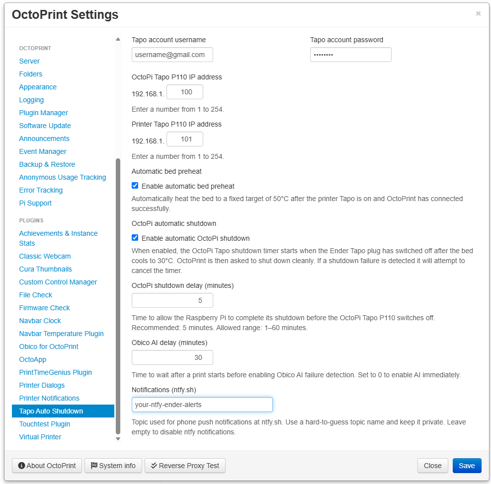

saw# **OctoPrint-TapoAutoShutdown v0.3.2.2**

## Version differences

**v0.2.0 — Original version Printer shutdown control**

Provides automatic printer Tapo P110 shutdown and Obico AI monitoring management, with configurable delays.

* Controls the Tapo P110 connected to the 3D printer.
* Provides a configurable printer shutdown delay.
* Manages Obico AI failure detection around print jobs.

**v0.3.0 — Additional optional OctoPi shutdown control**

Retains the existing printer shutdown and Obico AI features and adds improved control of a second Tapo P110 connected to the Raspberry Pi running OctoPrint.

* Adds a separate Tapo P110 IP address for the Raspberry Pi.
* Uses the same Tapo account credentials for both smart plugs.
* Provides a configurable OctoPi power-off timer.
* Waits for successful timelapse rendering before starting the OctoPi shutdown sequence.
* Verifies the power-off timer before requesting a clean Linux shutdown.
* Attempts to clear the timer if the shutdown request fails.

*Important: The OctoPi shutdown feature is optional. The smart plug timer operates independently of Linux, so allow sufficient time for the Raspberry Pi to shut down cleanly before power is cut.*

**v0.3.1 — Automatic printer connection**

Retains the existing printer shutdown, optional OctoPi shutdown, and Obico AI monitoring features. Adds development work to monitor the printer’s Tapo P110 power consumption and initiate an automatic OctoPrint connection when the measured power exceeds 9 W.

* Uses the existing printer Tapo P110 IP address.
* Uses the tapo Python package to read current power consumption.
* Targets automatic connection when power exceeds 9 W.
* Automatic connection to OctoPi when PSU is turned on.
* Existing shutdown timers, power-off actions, and timelapse handling are intended to remain unchanged.

**v0.3.2 — Added optional preheat bed checkbox and send push notification when it's safe to remove print**

* Checking the Printer bed temp and Tapo power plug wattage then turn off the plug
* Added warning box to remind to turn on the cabinet light.
* Added warning box to show that the bed is preheating
* Added warning box to show that the bed has reached the desired preset temperature.
* Added warning boxes to tell the user to try to remove a print at 40°C+ a final reminder at 32°C
* Added warning box to show that the printer has turned off at 30°C

**v0.3.2.2 — Added ntfy push notifications (this is for Alex) and a separate TASD log**

* Fixed the need to reboot OctoPrint so that the TASD plugin settings screen appears. After the v0.3.0.1 minor update.
* Changed the settings layout so you only need to change the last part of each Tapo's IP address.
* Added dedicated plugin_tapoautoshutdown.log for easier diagnosis of any potential Tapo communication errors.
* Requires the free ntfy iOS/Android app and a unique subscribed topic for the user, download available @ https://ntfy.sh/
* The free version without a paid account will allow 250 FREE notifications per day, plenty for OctoPrint with TASD plugin.
* Sends a notification when the bed preheating command is issued, including the target temperature.
* Sends the first notification when the bed cools to 40°C, reminding the user that the print may be ready to remove.
* Sends the second reminder notification when the bed cools to 32°C, indicating that printer's Tapo plug will switch off at 30°C.
* Sends a final notification when the printer’s Tapo plug is switched off after the bed cools to 30°C. This usually takes at least 15 mins.
* Notification delivery requires the Raspberry Pi to have network access.
* Notification failures should not interrupt printer control or the shutdown sequence.

**Upgrading to the latest version**

* Latest version retains the existing printer shutdown and Obico AI monitoring functionality while introducing the additional OctoPi plug controls.
* To use automatic OctoPi shutdown, a second compatible Tapo P110 is required. 
* Configure the OctoPi Tapo's IP address separately from the printer plug.
* Both plugs will use the same Tapo account credentials from their application.
* After upgrading, review the plugin settings and verify the configuration before enabling automatic OctoPi shutdown.

## Features

### Printer Tapo P110

- Automatically switches off the printer's Tapo P110 after the bed has cooled to 30°C.
- Uses a dedicated IP address for the printer's smart plug.
- Controls the printer plug independently of the OctoPi plug.

### OctoPi Tapo P110

- Supports a second Tapo P110 to control power to the Raspberry Pi running OctoPrint.
- Uses a separate IP address for the OctoPi smart plug.
- Provides an option to enable or disable OctoPi plug control.
- Provides a separate option to enable or disable automatic OctoPi shutdown.
- Waits for successful timelapse rendering before starting the automatic shutdown sequence.
- Arms and verifies the Tapo power-off timer before requesting a clean Linux shutdown.
- Provides a configurable OctoPi shutdown delay in minutes.
- Cancels automatic shutdown if timelapse rendering fails.

### Obico AI monitoring

- Automatically disables Obico AI failure detection when a print starts.
- Provides a configurable delay before AI failure detection is enabled.
- Enables AI monitoring after the selected delay if the print is still running.
- Disables AI monitoring when a print completes, is cancelled, or fails.
- Setting the Obico delay to 0 enables AI monitoring immediately, as the print begins.
- Helps reduce unnecessary Obico AI-hour usage while the printer is idle or during the early part of a print.
- This makes sure that if you forget to turn it ON, after you've checked the first few layers before a long print.

### Plugin Settings

Configure Tapo, automatic bed preheating, OctoPi shutdown,
Obico AI delay and ntfy notifications through the OctoPrint
settings interface.

### Setting	Description

- Tapo account username	Username and Password for the Tapo account
- Printer Tapo P110 IP address IP address of the 3D Printer's smart plug
- OctoPi Tapo P110 IP address	IP address of the Raspberry Pi's smart plug
- Enable OctoPi Tapo P110	Enables control of the second smart plug
- Shut down OctoPi	Enables automatic Raspberry Pi shutdown
- Printer shutdown delay	Time to wait before switching off the printer plug
- OctoPi shutdown delay	Time allowed for Linux to shut down before the Pi plug switches off
- Obico AI delay	Time to wait before enabling Obico AI failure detection
- Both smart plugs use the same Tapo account credentials while retaining separate IP addresses and independent shutdown behaviour.

## Shutdown safety

- Important: Automatic OctoPi shutdown is optional and should be enabled only after careful testing.
- When automatic OctoPi shutdown is enabled, the plugin waits for a successful print and completed timelapse rendering. It then arms and verifies the Tapo P110 power-off timer before requesting a clean Linux shutdown.
- The smart plug timer operates independently of Linux. The plugin cannot guarantee that the Raspberry Pi has completely finished shutting down before the timer switches off the power.
- Choose a shutdown delay that provides sufficient time for your system to shut down cleanly. The default delay is 15 minutes, with a configured range of 1–60 minutes.
- If the Tapo timer cannot be armed and verified, the plugin cancels the automatic shutdown request.
- If the shutdown request fails after the timer has been armed, the plugin attempts to clear the timer.
- The printer shutdown feature is separate from the Raspberry Pi shutdown feature. Configure and test each independently.

## Requirements

- OctoPrint installed on a compatible system.
- A TP-Link Tapo P110 smart plug for the printer.
- A second TP-Link Tapo P110 smart plug if OctoPi power control is required.
- A compatible Python environment.
- The Python tapo package, version 0.11.1 used in the current development setup.
- The Obico OctoPrint plugin for Obico AI monitoring features.
- An Obico plan with AI hours available for AI failure detection.

## Compatibility

OctoPrint-TapoAutoShutdown is designed for use with TP-Link Tapo P110 smart plugs. The printer shutdown and OctoPi shutdown features use separate smart plugs and can be configured independently.
Obico AI monitoring features require the Obico OctoPrint plugin.
Compatibility with other Tapo hardware revisions, firmware versions, and software configurations may vary.

### Tested Setup

The following configuration was used during development and testing of the OctoPi shutdown functionality, you must have at least the latest Python Tapo package installed.

### Hardware

- Raspberry Pi 4 Model B (4 GB RAM)
- TP-Link Tapo P110 UK smart plug, hardware revision 1.0
  
### Software

- OctoPi 1.1.0
- OctoPrint 1.11.8
- Python 3.11.2 (32-bit)
- Python Tapo package 0.11.1

### Tapo Firmware

- Version 1.4.8, build 260804

*Firmware versions may vary by hardware revision and region. Check the Tapo app for the version installed on your smart plug.*
*The tested configuration does not guarantee compatibility with every combination of hardware, firmware, or software versions.*
*Other hardware and software combinations may work but have not necessarily been tested.*

## Installation

1. Open OctoPrint in your browser
2. Navigate to Settings → Plugin Manager.
3. Select Get More….
4. Use the option to install a plugin from a URL.
5. Enter the GitHub ZIP URL for the desired branch or release.
6. Install the plugin and allow OctoPrint to restart when prompted.
7. Open the plugin settings and configure the smart plug IP addresses and shared Tapo account credentials.

## GitHub repository:

https://github.com/SpideRaY/OctoPrint-TapoAutoShutdown-ObicoDelay

For the v0.3.2.2 branch, the ZIP URL is:

https://github.com/SpideRaY/OctoPrint-TapoAutoShutdown-ObicoDelay/archive/refs/heads/v0.3.2.2.zip

## Initial configuration and testing

- Configure the printer plug IP address.
- Configure the OctoPi plug IP address if using the second plug.
- Enter the Tapo account username and password.
- Configure the printer shutdown delay.
- Configure the OctoPi shutdown delay if required.
- Configure the Obico AI monitoring delay.
- Keep automatic OctoPi shutdown disabled until the configuration and shutdown sequence have been reviewed and tested.
- Check the OctoPrint logs for errors before enabling automatic shutdown.
- Do not interrupt a print or deliberately cut Raspberry Pi power as a test. Verify the Tapo timer behaviour and shutdown sequence safely before relying on automatic shutdown.

## Development

- This is an independently developed OctoPrint plugin by SpideRaY.
- The project aims to reduce unnecessary power consumption and Obico AI-hour usage while providing convenient, configurable smart-plug control for 3D printing.
- Development and testing are ongoing. Please report issues with relevant OctoPrint logs, plugin versions, hardware revisions and firmware details.

Repository

https://github.com/SpideRaY/OctoPrint-TapoAutoShutdown-ObicoDelay

## Author

**SpideRaY**

*Created to help save Power and the Planet.*
